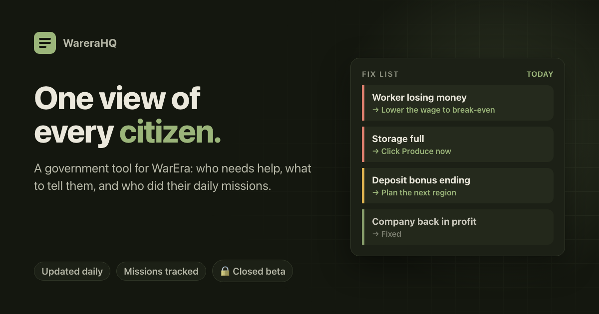
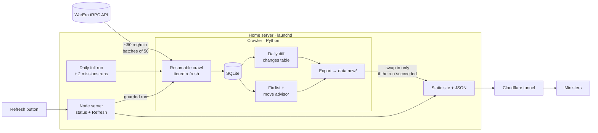

# WareraHQ

**A government tool for the strategy game [WarEra](https://warera.io).** It gives a country's ministers one view of every citizen: who needs help, the exact fix to send them, and who did their daily missions. Three times a day it reads the live game, works out each player's problems and exports a fast static site.

> 🔒 **Source is private, and the app is in a closed beta** with one country's government. This repo documents the system: architecture, pipeline design and engineering decisions. Public page: [warerahq.moezkayy.com/about](https://warerahq.moezkayy.com/about) · Story: [moezkayy.com/projects/warerahq](https://moezkayy.com/projects/warerahq/)

---

## At a glance

| | |
|---|---|
| **Pipeline** | Scheduled ELT: crawl → SQLite → diff → fix-list engine → static JSON export → atomic swap |
| **Schedule** | A full crawl once a day, plus two light missions-only runs (about 12 requests each) |
| **Scope** | Every citizen of a country gets a full profile, plus every party and military unit they belong to |
| **Hosting** | My own home server (launchd jobs), served through a Cloudflare tunnel, with health checks, weekly backups and phone alerts |
| **Tests** | 140+ Python tests for the crawler and fix list, plus Node tests for the web server and Refresh, no network needed |

## What ministers see

- **Country overview.** Summary cards and tables by party and by military unit, with filters.
- **Fix list.** Each owner's economic problems with the fix to send (table below).
- **Daily missions.** Who has claimed today's missions and who hasn't. A late-day run leaves time to nudge players; a final run records who missed the day.
- **Party, unit and player pages.** Members, companies and a history of changes, with each player's Discord name so ministers know who to message.
- **Refresh.** A guarded button to re-read the whole game on demand.

| Problem | Level | Fix shown |
|---|---|---|
| Worker costs more than they produce | 🔴 urgent | Lower the wage to break-even, or let them go |
| Company losing money at today's prices | 🔴 urgent | Cut wages, switch item, or move region |
| Storage full, production stopped | 🔴 urgent | Produce now |
| Worker barely profitable / storage ≥ 80% / deposit bonus ending < 24h | 🟡 watch | Plan ahead |
| Company would earn more in another region or making another item | 🟡 watch | Move, change item, or both |

## Architecture

## Engineering decisions worth talking about

**Visitors never touch the upstream API.** The crawler reads the game on a schedule; the site serves only pre-computed JSON, so it's instant and can't overload the game's servers.

**One job at a time, and failures change nothing.** Each run crawls and exports into a new folder, and only swaps it in once everything succeeded. A lock keeps runs from overlapping (timed jobs wait, Refresh doesn't), every run is logged, and a failed run alerts my phone.

**A polite, resilient crawler.**
- Self-imposed limit of 60 req/min (the API allows 100), honouring `ratelimit-*` headers
- tRPC batching: 50 calls count as one request, with HTTP 207 partial failures handled per call
- Backoff on 429/5xx and an identifying User-Agent
- Checkpointed steps, so a run cut short is continued by the next one; active players refreshed daily, inactive ones weekly

**Maths reused, not re-guessed.** The fix list is a port of [WarEra Buddy](https://github.com/moezkayy/warera-buddy)'s daily briefing, and the move advice is a copy of Buddy's region/item advisor. Checked against Buddy on a real account: all 10 companies' profit/day matched within 0.03.

**Privacy by design.** Account-private profile fields are dropped at ingest and never reach the database or the site. The one exception is a single "daily missions claimed" timestamp, kept because tracking missions is the point.

**Abuse-resistant Refresh.** It warns first, is refused while any run is in progress, and has a 30-minute cooldown.

**It grew out of an earlier project.** WareraHQ started as a copy of the [War Era Party Management Tool](https://github.com/moezkayy/warera-command-center), widened from one party to a whole country and moved from GitHub Actions + Cloudflare Pages to my home server.

---

Built by <a href="https://github.com/moezkayy">@moezkayy</a>. Unofficial fan project, not affiliated with WarEra. WarEra and its assets belong to their owners.
